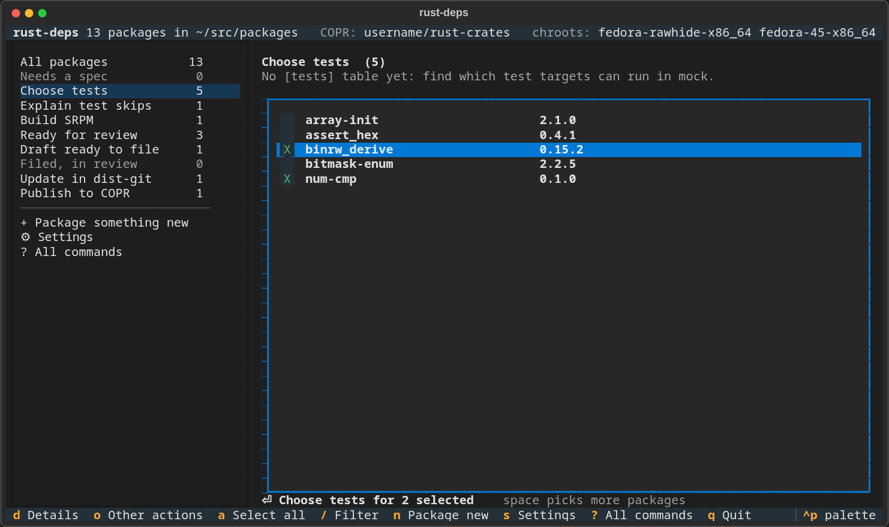
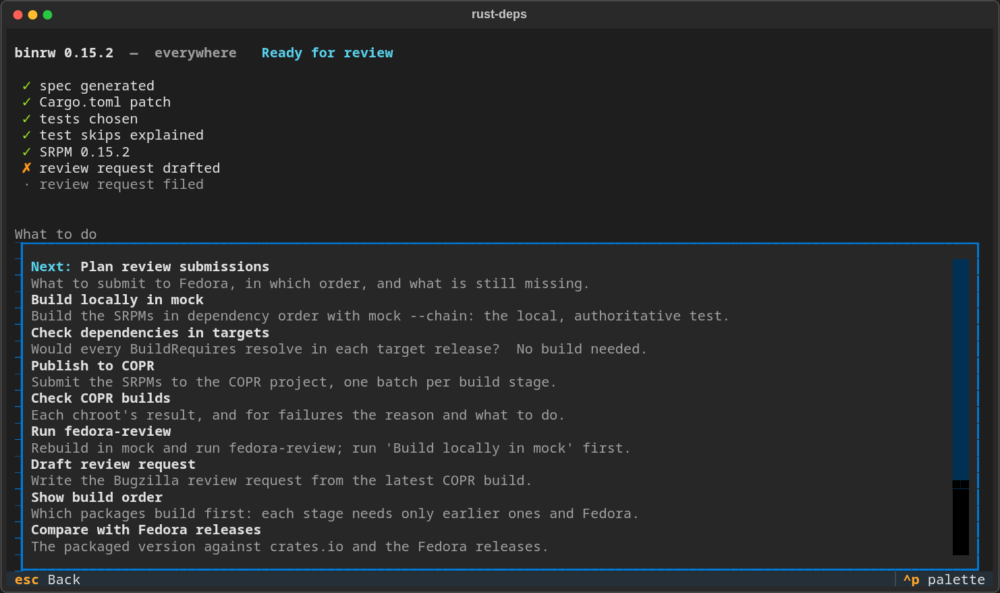
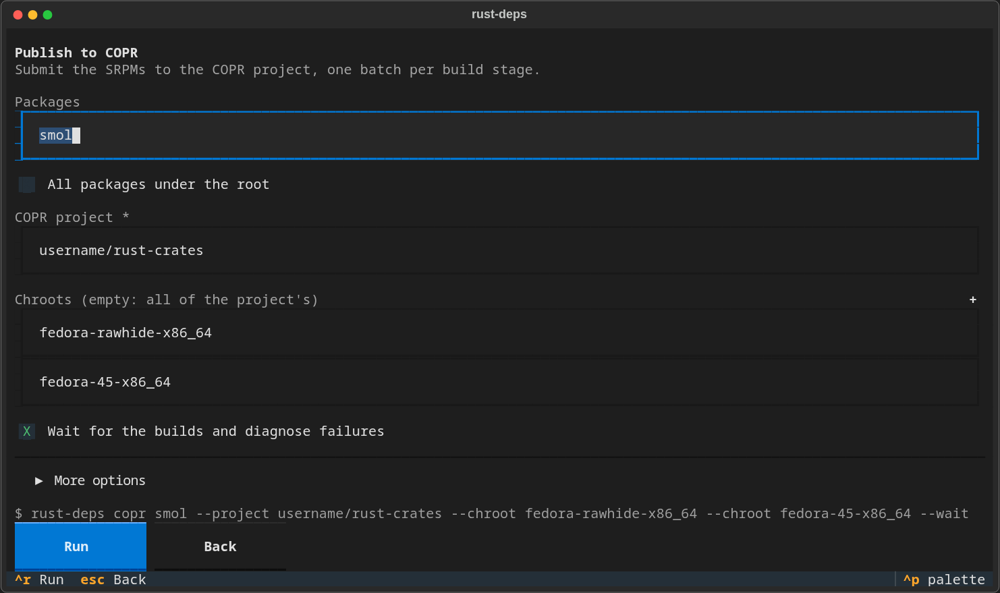
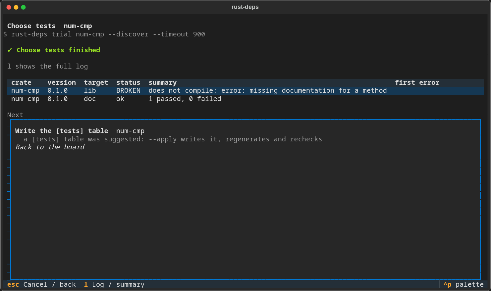
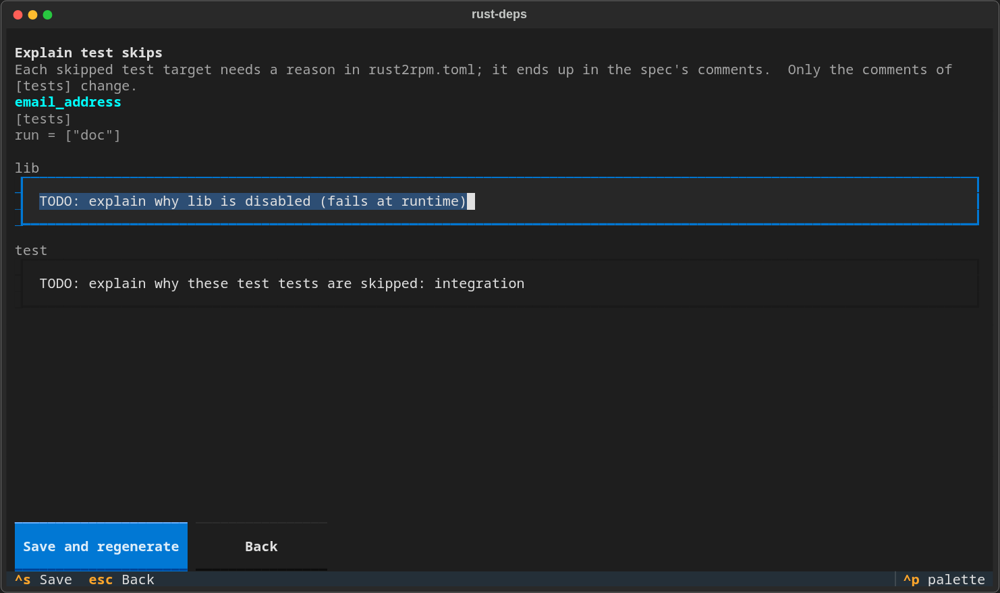

# rust-packaging-tools

Set of tools to aid packaging Rust crates for Fedora Project.

This project provides the **fedora-rust-packaging** skill. It packages Rust
crates for Fedora with rust2rpm, including every dependency crate that Fedora
is missing.

The project consists of two components:

- an [Agent Skill](https://agentskills.io): the `fedora-rust-packaging/`
  directory with `SKILL.md`, which Claude and other skill-enabled agents can
  use — the easiest way to get started, see [Use it through an agent](#use-it-through-an-agent)
- a command-line tool for people: `rust-deps`, in `fedora-rust-packaging/scripts/`
  — see [Use it standalone](#use-it-standalone)

```
rust-packaging-tools/
├── install.sh                     installs the skill and/or the command
└── fedora-rust-packaging/         the skill (self-contained, location independent)
    ├── SKILL.md                   instructions for agents
    ├── scripts/rust-deps          the tool's launcher: runs the package next to it
    │                              straight from a checkout, no installation needed
    ├── scripts/rust_deps/         the tool as components (Python 3.12+, no extra modules beyond
    │                              rust2rpm and python3-bugzilla; 'tui' uses python3-textual)
    └── references/MANUAL.md       the manual: workflow, file formats, fixes
```

Nothing refers to where the skill is installed or where your packages live.
Every command works on a *packages root* (one sub-directory per crate). The
root is `--root DIR`, else `$RUST_DEPS_ROOT`, else the current directory.

## Terms

This tool automates Fedora's packaging process for Rust crates. A few
Fedora-specific terms come up throughout this README and in `rust-deps`'
own output:

| Term | Meaning |
|---|---|
| crate | a Rust package, as published on [crates.io](https://crates.io) (e.g. `jsonschema`) — this is what you type on the command line |
| RPM | Fedora's installable package format; a crate named `jsonschema` becomes the RPM `rust-jsonschema` |
| SRPM | a *source* RPM: the recipe and sources needed to build an RPM, not something you install |
| rust2rpm | the upstream tool that turns a crate into an RPM spec file; `rust-deps` drives it and adds everything around it |
| mock | builds RPMs inside a clean, disposable environment, so a missing dependency shows up as a build failure instead of silently working on your machine |
| chroot | the target environment for a build, named like `fedora-45-x86_64` or `rhel+epel-10-x86_64` |
| COPR | Fedora's community build service: a place to build and share RPMs before (or without) submitting them to official Fedora |
| dist-git | Fedora's official git hosting for packages that are already part of Fedora |
| FAS | the Fedora Account System — your Fedora login |
| review request | Fedora requires a human review, tracked as a Bugzilla ticket, before a new package is accepted |

## Prerequisites

Either way you use this tool, the underlying system packages are the same:

```
sudo dnf install python3 rust2rpm cargo git rpm-build rpmdevtools rpmlint dnf5 patch util-linux iproute
# optional: mock, fedora-review (plus 'sudo usermod -aG mock $USER'), copr-cli, python3-textual (for 'tui')
```

Using [toolbx](https://containertoolbx.org/install/) is recommended, as it
allows easy environments for each Fedora release.

`rust2rpm` provides the `python3-cargo2rpm` module that `rust-deps` uses for
semver matching. Once installed (either path below), `rust-deps doctor`
checks all of this, including membership in the `mock` group and the user
namespaces (with a working loopback interface) that offline trials need:

```
$ rust-deps --root ~/src/packages doctor
   ok      rust2rpm   /usr/sbin/rust2rpm
   ok      cargo      /usr/sbin/cargo
   ok      rpmbuild   /usr/sbin/rpmbuild
   ok      spectool   /usr/sbin/spectool
   ok      rpmlint    /usr/sbin/rpmlint
   ok      dnf        /usr/sbin/dnf
   ok      patch      /usr/sbin/patch
   ok      unshare    /usr/sbin/unshare
   ok      ip         /usr/sbin/ip
   ok      mock       /usr/sbin/mock
   ok      copr-cli   /usr/sbin/copr-cli
   ok      fedora-review /usr/sbin/fedora-review
   ok      mock group
   root    /home/username/src/packages (19 packages)
```

## Use it through an agent

The easiest way to use this tool: ask an AI agent in plain English, and it
drives `rust-deps` for you.

### Install

```
./install.sh                          # Claude Code, all projects: ~/.claude/skills
./install.sh --project ~/src/myproj   # Claude Code, one project: <dir>/.claude/skills
./install.sh --agents                 # OMP (oh-my-pi) and others: ~/.agents/skills
./install.sh --dest DIR               # any other agent's skills directory
./install.sh --zip fedora-rust-packaging.zip   # archive for uploading as a skill
```

Targets can be combined (e.g. with `--bin`, see [Use it standalone](#use-it-standalone)).
Re-running `install.sh` updates an existing installation; it refuses to
overwrite anything that is not this skill. `--link …` symlinks instead of
copying (for development); `./install.sh --uninstall [targets…]` removes an
installation again.

### Run it

Once installed, just ask for the result, for example: "package the Rust
crates jsonschema needs for Fedora in ~/src/packages". The agent follows
`SKILL.md`: it runs `rust-deps` with your packages root, and resolves or
reports each problem. It builds in mock when you are in the `mock` group. It
hands decisions that affect other Fedora packages back to you.

To name the task directly, run the skill as a command with arguments:

| harness | command |
|---|---|
| Claude Code | `/fedora-rust-packaging jsonschema --root ~/src/packages` |
| OMP (oh-my-pi) | `/skill:fedora-rust-packaging jsonschema --root ~/src/packages` |

The arguments are crate names, `--manifest <Cargo.toml>`, or a single
`rust-deps` command such as `review-status --user <login>`; with none, the
agent asks.

#### OMP (oh-my-pi)

OMP loads user skills from `~/.agents/skills` (`./install.sh --agents`).
It ignores `~/.claude/skills` unless `skills.enableClaudeUser` is turned on
(`omp config set skills.enableClaudeUser true`), but it does load
project-level `.claude/skills`. Check that it sees the skill with
`omp read skill://fedora-rust-packaging`.

## Use it standalone

Prefer the terminal? Run `rust-deps` yourself, without an agent.

### Install

```
./install.sh --bin ~/.local/bin   # put 'rust-deps' on your PATH (with no other target:
                                   # nothing is installed and it links into this checkout)
```

Without installing at all, you can also run it straight from a checkout:
`./fedora-rust-packaging/scripts/rust-deps`.

Then set a packages root and check the [prerequisites](#prerequisites):

```
export RUST_DEPS_ROOT=~/src/packages
rust-deps doctor
```

### Run it

Arguments like `jsonschema` below are **crate names** (see [Terms](#terms)
above). Each crate gets its own sub-directory under the packages root. The
commands form a pipeline: resolve what's missing, create packages, test,
build, review, submit. Most commands also accept `--all` to operate on every
package under the root instead of naming crates.

#### 1. Find what Fedora is missing

```
rust-deps resolve jsonschema                        # what does this crate need that Fedora lacks?
rust-deps resolve jsonschema@0.28                   # pin a version requirement
rust-deps resolve -r rhel+epel-10-x86_64 jsonschema # check against RHEL/EPEL instead of the host
rust-deps workspace ~/src/myproject                 # a Rust workspace: what it needs, and where from;
                                                     # what Fedora ships must not be vendored
```

#### 2. Create the packages

```
rust-deps init --recursive jsonschema   # create a package dir for the crate and every missing dependency
```

#### 3. Choose which tests can run

```
rust-deps trial --discover --apply jsonschema   # try all test targets, write the [tests] table
```

#### 4. Build

```
rust-deps srpm --all && rust-deps mock-chain --all -r fedora-45-x86_64
# — or submit to COPR instead of (or after) mock: —
rust-deps check-targets --all --project username/repo   # will every chroot find its BuildRequires?
rust-deps copr --all --project username/repo -r fedora-rawhide-x86_64 --wait
rust-deps copr-status --all --project username/repo   # why builds failed, per chroot
rust-deps copr-log jsonschema -r fedora-44-x86_64 --project username/repo   # errors, explained warnings
rust-deps copr --retry-failed --all --project username/repo   # resubmit what can succeed now
```

#### 5. Review and submit

```
rust-deps review --all -r fedora-45-x86_64      # fedora-review, before submitting
rust-deps review-plan --all --project username/repo   # what to submit, in which order, which drafts are ready
rust-deps review-request --all --project username/repo --fas username   # drafts; --file files them
rust-deps review-status --all                   # reviewer comments, next steps
rust-deps request-repo --all                     # after approval: ask for the dist-git repo
```

| Option | Meaning |
|---|---|
| `CRATE` | a crate name from crates.io (e.g. `jsonschema`, `serde`) |
| `--root DIR` | packages root (default: `$RUST_DEPS_ROOT`, else the current directory) |
| `--all` | every package under the root, instead of naming crates |
| `--project USER/REPO` | a COPR project, e.g. `username/repo` |
| `-r CHROOT` | a mock/COPR chroot, e.g. `fedora-45-x86_64`, `rhel+epel-10-x86_64` |
| `--fas NAME` | your Fedora Account System username |

Beyond the pipeline above: `status --project username/repo` compares local
packages against crates.io and each Fedora/EPEL release; `update CRATE
--version V` moves a package to a new upstream release, in build order;
`dist-git --dir ~/src/fedora zmij` puts the local packaging in Fedora's repository: an
update commit for a package already in Fedora, or the import into one your request created;
`tmt --all --project username/repo -r fedora-45-x86_64` runs the generated Fedora CI tests (add
`--host` from inside a toolbox container); `review-status --user username`
lists all your review tickets, tracked in `~/.cache`. Run `rust-deps COMMAND
--help` for any command's full options, or see the reference below.

### The text UI

Rather than remembering commands, `rust-deps tui` is a terminal UI (built
with [Textual](https://github.com/Textualize/textual)) that walks a packager
through the lifecycle (needs `python3-textual`):

```
rust-deps tui
```

It opens on a **board**: the stages a package goes through — *Needs a spec*,
*Choose tests*, *Explain test skips*, *Build SRPM*, *Ready for review*,
*Draft ready to file*, *Filed, in review*, *Approved, importing*, and the
*Update in dist-git* and *Publish to COPR* branches — each with the packages it
holds and the one action that moves them on. Pick packages with `space` and press `enter`: an
**action sheet** shows the few inputs that matter, filled from **Settings**
asked once per root (COPR project, chroots, FAS account; kept in
`~/.cache/rust-packaging-tools`), everything else folded under *More
options*, and the exact `rust-deps …` line it runs. The **run view** streams
the log, then sums it up: the verdict, every `ACTION NEEDED` left to fix by
hand, the result as a table, and the next steps — the ones the tool's own
output proposes and the ones the packages' new stages imply. `d` shows one
package's checklist and its next step, `o` the other actions that fit, `n`
starts something new from crate names or a project path, and `?` lists every
command with all its options (forms generated from the same argparse
metadata as `--help`).



*The board: every stage with its packages; pick some and press `enter` for the
stage's action.*



*`d` on a package: what it has, the step it is at, and what to do next.*



*An action sheet: the inputs that matter, filled from Settings; the rest under
More options; the exact command line below.*



*After a run: the verdict, the result as a table, and the next step — here
test discovery found the unit tests broken and offers to write the `[tests]`
table.*



*Explain test skips: the TODO reasons discovery wrote, edited in place; saving
regenerates the spec.*

The full workflow and reference is in
[`fedora-rust-packaging/references/MANUAL.md`](fedora-rust-packaging/references/MANUAL.md).

## Tests

```
python3 -m pytest tests          # unit tests: offline, need python3-pytest, python3-pyyaml
                                 # and rust2rpm (for its cargo2rpm module)
tests/smoke.sh [crate@version]   # end to end on a crate from crates.io (default num-cmp@0.1.0):
                                 # doctor, resolve, init, regen, trial, srpm, order,
                                 # workspace, check-targets, copr -n, status; needs network
```

GitHub Actions runs both in a Fedora container on every push and pull request
(`.github/workflows/test.yml`); the smoke test's container is privileged, as
`trial` runs tests offline in a user namespace.
